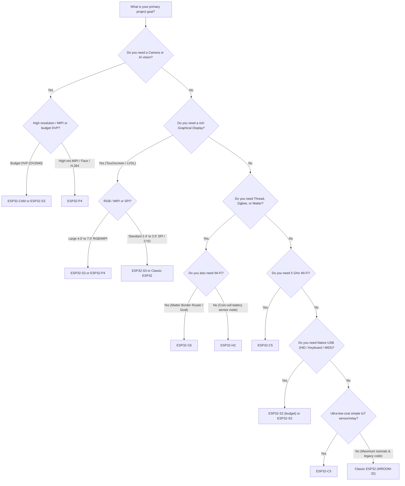

# 🔬 ESP32 Family Chip Comparison Guide

> **The definitive technical comparison of every Espressif ESP32 System-on-Chip (SoC)** — from the legendary original ESP32 to modern RISC-V champions (C3, C6, H2) and high-performance HMI application processors (S3, P4).

---

## 📊 Complete SoC Specification Matrix

| Feature | Classic ESP32 | ESP32-S2 | ESP32-S3 | ESP32-C2 | ESP32-C3 | ESP32-C5 | ESP32-C6 | ESP32-H2 | ESP32-P4 |
| :--- | :--- | :--- | :--- | :--- | :--- | :--- | :--- | :--- | :--- |
| **CPU Architecture** | Xtensa LX6 | Xtensa LX7 | Xtensa LX7 | RISC-V | RISC-V | RISC-V | RISC-V | RISC-V | RISC-V (HP) + RISC-V (LP) |
| **CPU Cores** | 2 (Dual) | 1 (Single) | 2 (Dual) | 1 (Single) | 1 (Single) | 1 (Single) | 1 (Single) | 1 (Single) | 2 (Dual HP) + 1 (LP) |
| **Max Frequency** | 240 MHz | 240 MHz | 240 MHz | 120 MHz | 160 MHz | 240 MHz | 160 MHz | 96 MHz | 400 MHz (HP) / 40 MHz (LP) |
| **SRAM** | 520 KB | 320 KB | 512 KB | 272 KB | 400 KB | 400 KB | 512 KB | 320 KB | 768 KB (On-chip) |
| **ROM** | 448 KB | 128 KB | 384 KB | 576 KB | 384 KB | 384 KB | 320 KB | 128 KB | 128 KB |
| **Max PSRAM** | Up to 8 MB (SPI) | Up to 8 MB (SPI) | Up to 16 MB (Octal) | N/A | N/A | N/A | N/A | N/A | Up to 32 MB (HP-PSRAM) |
| **Wi-Fi** | Wi-Fi 4 (2.4 GHz) | Wi-Fi 4 (2.4 GHz) | Wi-Fi 4 (2.4 GHz) | Wi-Fi 4 (2.4 GHz) | Wi-Fi 4 (2.4 GHz) | **Dual-band Wi-Fi 6** (2.4 & 5 GHz) | **Wi-Fi 6** (2.4 GHz) | ❌ None | ❌ None (Requires Companion) |
| **Bluetooth** | Classic (BR/EDR) + BLE 4.2 | ❌ None | Bluetooth 5.0 (LE) | Bluetooth 5.0 (LE) | Bluetooth 5.0 (LE) | Bluetooth 5.0 (LE) | Bluetooth 5.0 (LE) | Bluetooth 5.0 (LE) | ❌ None (Requires Companion) |
| **IEEE 802.15.4** | ❌ None | ❌ None | ❌ None | ❌ None | ❌ None | ❌ None | **Thread & Zigbee** | **Thread & Zigbee** | ❌ None |
| **Matter Protocol** | Over Wi-Fi | Over Wi-Fi | Over Wi-Fi | Over Wi-Fi | Over Wi-Fi | Over Wi-Fi | **Matter-over-Thread & Wi-Fi** | **Matter-over-Thread** | Via Companion |
| **AI Vector Acceleration** | ❌ None | ❌ None | **✅ Vector Instructions (PIE)** | ❌ None | ❌ None | ❌ None | ❌ None | ❌ None | **✅ DSP + 2D-DMA + H.264** |
| **USB Support** | Via Bridge IC | **Native USB-OTG 1.1** | **Native USB-OTG 1.1 + Serial/JTAG** | ❌ Bridge IC | Native Serial/JTAG | Native Serial/JTAG | Native Serial/JTAG | Native USB-Serial/JTAG | **High-Speed USB 2.0 OTG (480 Mbps)** |
| **Display Interface** | SPI / 8-bit Parallel | SPI / 8-bit Parallel | SPI / 8-bit / 16-bit RGB | SPI | SPI | SPI | SPI | SPI | **MIPI-DSI (2-lane) + RGB** |
| **Camera Interface** | 8-bit DVP (I2S DMA) | 8-bit DVP | 8/16-bit DVP (Dedicated) | ❌ None | ❌ None | ❌ None | ❌ None | ❌ None | **MIPI-CSI (2-lane) + 16-bit DVP** |
| **Max GPIOs** | 34 (36 on WROVER) | 43 | 45 | 14 | 22 | 29 | 30 | 26 | 50+ |
| **Typical Target Cost** | $2.50 – $4.00 | $2.00 – $3.50 | $3.50 – $6.00 | $1.20 – $1.80 | $1.50 – $2.50 | $2.50 – $3.80 | $2.20 – $3.50 | $2.00 – $3.00 | $5.00 – $8.00 |

---

## 🎯 Which ESP32 Should You Choose?

---

## 📌 Deep-Dive per Chip Family

### 1. Classic ESP32 (ESP32-D0WDQ6, WROOM-32, WROVER)
- **Architecture**: Xtensa dual-core 32-bit LX6 up to 240 MHz.
- **Why Choose It**: The granddaddy of IoT microcontrollers. Has the largest volume of online tutorials, libraries, StackOverflow answers, and proven stability.
- **Key Caveats**:
  - GPIO 6–11 are permanently wired to internal SPI flash (DO NOT USE).
  - ADC2 cannot be used when Wi-Fi is active.
  - Strapping pins (GPIO 0, 2, 5, 12, 15) dictate boot mode.

### 2. ESP32-S3 (The AI & Display Powerhouse)
- **Architecture**: Xtensa dual-core LX7 up to 240 MHz with vector extensions.
- **Why Choose It**: The absolute gold standard for modern projects:
  - Hardware AI acceleration for speech recognition and image classification.
  - Native USB OTG: Emulate keyboards, mice, flash drives, and MIDI instruments.
  - Dedicated LCD and Camera peripherals with direct DMA.
  - Up to 16 MB high-speed Octal PSRAM.

### 3. ESP32-C3 (The Modern RISC-V Workhorse)
- **Architecture**: Single-core 32-bit RISC-V up to 160 MHz.
- **Why Choose It**: The official successor to the legendary ESP8266. Compact, ultra-low-cost, modern BLE 5.0, secure boot, and hardware crypto accelerators.
- **Ideal For**: Smart plugs, temperature nodes, relay switches, Bluetooth beacons.

### 4. ESP32-C6 (The Ultimate Matter & Smart Home SoC)
- **Architecture**: Single-core 32-bit RISC-V up to 160 MHz.
- **Why Choose It**: First Espressif chip to support **Wi-Fi 6 (802.11ax)** and **IEEE 802.15.4 (Thread/Zigbee)** on the same silicon.
- **Ideal For**: Home Assistant Thread border routers, Zigbee switches, native Matter devices.

### 5. ESP32-H2 (Ultra-Low Power Mesh Specialist)
- **Architecture**: Single-core 32-bit RISC-V at 96 MHz.
- **Why Choose It**: Intentionally strips out Wi-Fi to achieve record-low sleep currents.
- **Ideal For**: Battery-powered or coin-cell Zigbee temperature sensors, door/window magnetic contacts, Thread endpoints.

### 6. ESP32-P4 (Next-Gen High Performance HMI)
- **Architecture**: Dual-core HP RISC-V @ 400 MHz + LP RISC-V @ 40 MHz.
- **Why Choose It**: Designed for high-end multimedia dashboards, MIPI displays, hardware H.264 video encoding, and graphical user interfaces running LVGL at 60+ FPS.

---

**Part of the [ESP32 Community Hub](https://github.com/tushar2704/ESP32-Community)**  
Maintained by Tushar Aggarwal ([@tushar2704](https://github.com/tushar2704)) • Tutorials on [@IamNotIntoTech](https://youtube.com/@IamNotIntoTech)

