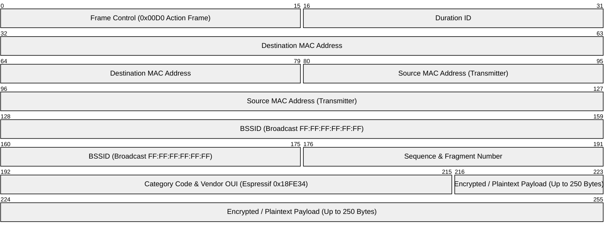

# 📡 The Definitive ESP-NOW Developer Guide

> **Master low-latency, zero-infrastructure peer-to-peer wireless networking on ESP32 microcontrollers.**

---

## 1. What is ESP-NOW?

**ESP-NOW** is a proprietary wireless communication protocol developed by Espressif that enables direct, packet-based communication between ESP8266 and ESP32 devices **without requiring a central Wi-Fi access point, router, or handshake connection phase**.

Unlike standard TCP/IP networking, ESP-NOW transmits raw 802.11 vendor-specific action frames on the 2.4 GHz industrial, scientific, and medical (ISM) radio band. This eliminates the multi-second DHCP lease assignment, 4-way WPA2 handshake, and ARP lookup overhead.

```
Standard Wi-Fi TCP/IP Architecture:
Node A  ──[802.11 Frame]──►  Wi-Fi Access Point / Router  ──►  Node B
(Latency: 50–250 ms, requires continuous beacon listening, high power draw)

ESP-NOW Peer-to-Peer Architecture:
Node A  ═════════════[Raw 802.11 Action Frame (<1 ms)]════════════►  Node B
(Latency: ~1 ms, zero router infrastructure, microsecond battery wakeups)
```

---

## 2. Technical Specifications & Limitations

| Parameter | Specification | Notes |
| :--- | :---: | :--- |
| **Physical Frequency** | 2.4 GHz (Channels 1–14) | Both peers must reside on the identical channel |
| **Max Payload Size** | **250 bytes** | Per individual transmission frame |
| **Unencrypted Peers** | Up to **20** peers | Classic ESP32, S3, C3, C6 |
| **Encrypted Peers** | Up to **6** peers (Classic), **10** (S3/C3) | Uses CCMP (AES-128 counter mode) |
| **Frame Delivery** | Unicast (ACK with auto-retry) or Broadcast | Broadcast uses `FF:FF:FF:FF:FF:FF` (no ACK) |
| **Power Consumption** | ~70–120 mA during active 1ms burst | Ultra-low average power when paired with Deep Sleep |
| **Range** | 100m–250m line of sight | Up to 1km with external directional antennas |

---

## 3. Frame Anatomy & Protocol Architecture



---

## 4. Initialization & Configuration Pattern

### Essential Setup Flow:
1. Initialize the Wi-Fi stack in **Station (`WIFI_STA`)** or **Station + AP (`WIFI_AP_STA`)** mode.
2. Disconnect from any current AP (`WiFi.disconnect()`) to lock radio channel stability.
3. Call `esp_now_init()`.
4. Register transmission and receive callbacks: `esp_now_register_send_cb()` and `esp_now_register_recv_cb()`.
5. Add target peers via `esp_now_add_peer()`.

```cpp
#include <WiFi.h>
#include <esp_now.h>

// Target Peer MAC Address (Replace with receiver MAC)
uint8_t peerMAC[] = { 0x24, 0x6F, 0x28, 0xAA, 0xBB, 0xCC };

// Data structure to exchange (max 250 bytes)
typedef struct struct_message {
  uint32_t messageId;
  float    temperature;
  float    humidity;
  bool     alarmState;
} struct_message;

struct_message telemetryData;

// Send Callback
void onDataSent(const uint8_t *mac_addr, esp_now_send_status_t status) {
  Serial.print("[ESP-NOW] Send Status: ");
  Serial.println(status == ESP_NOW_SEND_SUCCESS ? "Success (ACK)" : "Fail (No ACK)");
}

// Receive Callback
void onDataRecv(const uint8_t *mac, const uint8_t *incomingData, int len) {
  if (len == sizeof(struct_message)) {
    memcpy(&telemetryData, incomingData, sizeof(struct_message));
    Serial.printf("[ESP-NOW] Rx from %02X:%02X:%02X:%02X:%02X:%02X -> Temp: %.1fC\n",
                  mac[0], mac[1], mac[2], mac[3], mac[4], mac[5], telemetryData.temperature);
  }
}

void setup() {
  Serial.begin(115200);
  WiFi.mode(WIFI_STA);
  WiFi.disconnect();

  if (esp_now_init() != ESP_OK) {
    Serial.println("[ESP-NOW] Error initializing!");
    return;
  }

  esp_now_register_send_cb(onDataSent);
  esp_now_register_recv_cb(onDataRecv);

  // Register peer
  esp_now_peer_info_t peerInfo = {};
  memcpy(peerInfo.peer_addr, peerMAC, 6);
  peerInfo.channel = 1;
  peerInfo.encrypt = false;

  if (esp_now_add_peer(&peerInfo) != ESP_OK) {
    Serial.println("[ESP-NOW] Failed to add peer!");
  }
}
```

---

## 5. Security & CCMP Hardware Encryption

To prevent packet sniffing, eavesdropping, and replay attacks on raw 802.11 frames, ESP-NOW supports CCMP 128-bit hardware encryption.

1. **Primary Master Key (PMK)**: 16-byte key set globally using `esp_now_set_pmk()`.
2. **Local Master Key (LMK)**: 16-byte key configured uniquely per peer in `peerInfo.lmk`.

```cpp
// 16-byte Secret Keys
const uint8_t PMK_KEY[16] = { "GLOBAL_PMK_2026" };
const uint8_t LMK_KEY[16] = { "PEER_SECRET_KEY1" };

esp_now_set_pmk(PMK_KEY);

esp_now_peer_info_t peerInfo = {};
memcpy(peerInfo.peer_addr, peerMAC, 6);
memcpy(peerInfo.lmk, LMK_KEY, 16);
peerInfo.encrypt = true;
esp_now_add_peer(&peerInfo);
```

---

## 6. Real-World Applications in This Repository

1. **[04-esp-now-mesh](projects/advanced/04-esp-now-mesh/)**: Decentralized sensor telemetry mesh with auto-node discovery.
2. **[06-walkie-talkie](projects/audio/06-walkie-talkie/)**: Sub-15ms real-time digital voice communication over raw I2S PCM frames.
3. **[03-wardriver](projects/security/03-wardriver/)**: Remote Wi-Fi audit coordination between mobile sniffers.

---

<div align="center">

**Part of the [ESP32 Community Hub](https://github.com/tushar2704/ESP32-Community)**  
<sub>Maintained by Tushar Aggarwal ([@tushar2704](https://github.com/tushar2704)) • Videos on [@IamNotIntoTech](https://youtube.com/@IamNotIntoTech) & [@Makerrdesigns](https://youtube.com/@Makerrdesigns)</sub>

</div>
