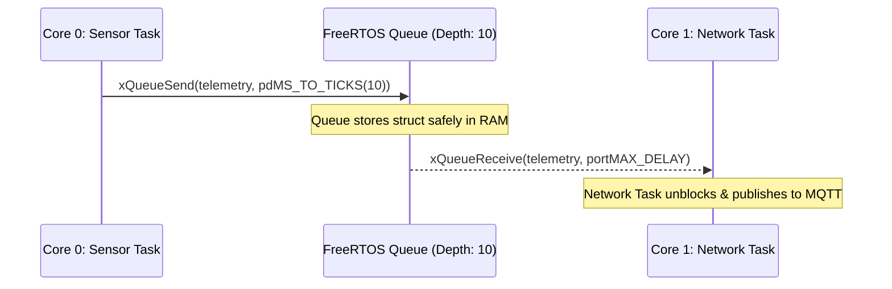

# ⚙️ Mastering FreeRTOS on ESP32 & Asymmetric Multiprocessing

> **Unlock the full deterministic power of ESP32's dual-core Xtensa / RISC-V architecture using FreeRTOS.**

---

## 1. Dual-Core Asymmetric Multiprocessing (AMP/SMP)

Standard Arduino microcontrollers are single-threaded: everything executes sequentially inside `setup()` and `loop()`. If an HTTP request blocks for 2 seconds, your sensor sampling and motor PID loops freeze.

The ESP32 changes this completely with **two independent 32-bit CPU cores**:
- **Core 0 (Protocol / PRO CPU)**: Handles Wi-Fi, Bluetooth Low Energy baseband, TCP/IP stack, and system house-keeping.
- **Core 1 (Application / APP CPU)**: Executes the default Arduino `setup()` and `loop()` tasks.

```
                      ESP32 Dual-Core Architecture
   ┌────────────────────────────────┐    ┌────────────────────────────────┐
   │         CORE 0 (PRO_CPU)       │    │         CORE 1 (APP_CPU)       │
   │  - Wi-Fi PHY & MAC Subsystem   │    │  - Arduino setup() & loop()    │
   │  - Bluetooth Controller & Host │    │  - Display UI (OLED / TFT)     │
   │  - Real-Time Sensor ISRs       │    │  - Motor Control PID Loop      │
   │  - Background HTTP/MQTT Daemon │    │  - Audio DSP Decoding          │
   └───────────────┬────────────────┘    └────────────────┬───────────────┘
                   │                                      │
                   └───────────────► Queues ◄─────────────┘
                                   Mutexes
                                 Event Groups
```

---

## 2. Core Primitives of FreeRTOS

### A. Tasks (`xTaskCreatePinnedToCore`)
A task is an independent thread of execution with its own stack and priority (0 to 24).

```cpp
TaskHandle_t SensorTaskHandle = NULL;

void SensorTask(void *pvParameters) {
  TickType_t xLastWakeTime = xTaskGetTickCount();
  const TickType_t xFrequency = pdMS_TO_TICKS(100); // 10 Hz exact periodicity

  for (;;) {
    // Read ADC / Sensors
    int val = analogRead(34);
    
    // vTaskDelayUntil guarantees deterministic frequency without jitter
    vTaskDelayUntil(&xLastWakeTime, xFrequency);
  }
}

void setup() {
  xTaskCreatePinnedToCore(
    SensorTask,          // Function pointer
    "Sensor_Task",       // Descriptive name
    4096,                // Stack size in bytes
    NULL,                // Parameter to pass
    2,                   // Task priority (higher number = higher priority)
    &SensorTaskHandle,   // Task handle
    0                    // Pin to Core 0 (or 1, or tskNO_AFFINITY)
  );
}
```

---

### B. Queues (`xQueueCreate`, `xQueueSend`, `xQueueReceive`)
Queues provide **thread-safe, FIFO inter-task data passing**. They automatically handle mutual exclusion and task blocking.



```cpp
typedef struct {
  float temperature;
  uint32_t timestamp;
} SensorData;

QueueHandle_t sensorQueue;

void setup() {
  // Create queue capable of holding 10 SensorData items
  sensorQueue = xQueueCreate(10, sizeof(SensorData));
}

void ProducerTask(void *pvParameters) {
  SensorData data;
  for (;;) {
    data.temperature = 24.5f;
    data.timestamp = millis();
    // Block up to 50ms if queue is full
    xQueueSend(sensorQueue, &data, pdMS_TO_TICKS(50));
    vTaskDelay(pdMS_TO_TICKS(500));
  }
}

void ConsumerTask(void *pvParameters) {
  SensorData received;
  for (;;) {
    // Block indefinitely until an item arrives in queue
    if (xQueueReceive(sensorQueue, &received, portMAX_DELAY) == pdPASS) {
      Serial.printf("[Queue] Received Temp: %.1fC at %ums\n", received.temperature, received.timestamp);
    }
  }
}
```

---

### C. Mutexes & Critical Sections
When two tasks must access a shared peripheral (e.g. an I2C bus or an SD card), a **Mutex** ensures that only one task accesses the bus at a time.

```cpp
SemaphoreHandle_t i2cMutex;

void setup() {
  i2cMutex = xSemaphoreCreateMutex();
}

void TaskA(void *pv) {
  for (;;) {
    if (xSemaphoreTake(i2cMutex, pdMS_TO_TICKS(100)) == pdTRUE) {
      // Safely perform I2C read/write
      Wire.requestFrom(0x68, 6);
      xSemaphoreGive(i2cMutex); // Release lock
    }
    vTaskDelay(pdMS_TO_TICKS(50));
  }
}
```

---

## 3. Best Practices & Pitfalls

> [!CAUTION]
> **Avoid `delay()` in High-Priority Tasks**  
> Always use `vTaskDelay(pdMS_TO_TICKS(ms))` instead of Arduino `delay()`. `vTaskDelay` relinquishes CPU time to lower-priority tasks.

> [!WARNING]
> **Task Watchdog Timer (TWDT)**  
> On ESP32, if a high-priority task running on Core 0 never yields (`vTaskDelay` or blocking I/O), the IDLE task on Core 0 starves, triggering a **Task Watchdog Timer panic restart** after 5 seconds. Always ensure your task yields!

---

<div align="center">

**Part of the [ESP32 Community Hub](https://github.com/tushar2704/ESP32-Community)**  
<sub>Maintained by Tushar Aggarwal ([@tushar2704](https://github.com/tushar2704)) • Videos on [@IamNotIntoTech](https://youtube.com/@IamNotIntoTech) & [@Makerrdesigns](https://youtube.com/@Makerrdesigns)</sub>

</div>
