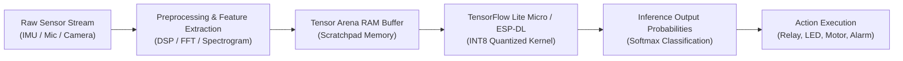

# 🧠 Embedded Edge AI & TinyML on ESP32

> **Deploy machine learning models directly on microcontrollers with zero cloud dependencies, sub-millisecond inference times, and minimal power consumption.**

---

## 1. What is TinyML?

**TinyML (Tiny Machine Learning)** is the field of running optimized deep learning neural networks directly on edge microcontrollers (like ESP32, ESP32-S3, and ESP32-C3) without streaming data to a cloud server.

### Why Run ML Locally on ESP32?
- 🔒 **Absolute Privacy**: Sensitive audio, video, and biometric sensor data never leaves the microcontroller.
- ⚡ **Zero Network Latency**: Inferences execute in 2–20 milliseconds without waiting for server round-trips.
- 🔋 **Extreme Energy Efficiency**: Radios (Wi-Fi/4G) draw 100–300mA. Running on-chip ML inference draws only ~30mA.
- 🌐 **100% Offline Autonomy**: Operates seamlessly in remote forests, industrial basements, and offshore locations.

---

## 2. TinyML Architecture & Lifecycle



---

## 3. Supported Frameworks for ESP32

| Framework | Best For | Hardware Target | Acceleration |
| :--- | :--- | :---: | :--- |
| **TensorFlow Lite Micro (TFLM)** | Motion, Gesture, Anomaly Detection | All ESP32 chips | Standard C++ kernels |
| **Edge Impulse SDK** | Audio Keyword Spotting & Sensor Fusion | All ESP32 chips | CMSIS / Espressif DSP |
| **ESP-DL** | Computer Vision & Face Detection | **ESP32-S3** | **Xtensa LX7 Vector Instructions (SIMD)** |

---

## 4. INT8 Quantization: Fitting Models in 100KB RAM

Standard machine learning models use 32-bit floating-point numbers (`float32`). A weights array of 250,000 floats consumes **1 MB of RAM**—far too large for embedded microcontrollers.

**Post-Training Quantization** converts 32-bit floats into 8-bit signed integers (`int8`):
$$\text{Memory Reduction} = \frac{32 \text{ bits}}{8 \text{ bits}} = 4\times \text{ smaller}$$

Additionally, on the **ESP32-S3**, the Xtensa LX7 dual-core processor includes **vector instructions** that execute up to eight 8-bit integer multiply-accumulate (MAC) operations in a single clock cycle!

---

## 5. End-to-End TFLM Implementation Pattern

```cpp
#include <TensorFlowLite_ESP32.h>
#include "tensorflow/lite/micro/all_ops_resolver.h"
#include "tensorflow/lite/micro/micro_error_reporter.h"
#include "tensorflow/lite/micro/micro_interpreter.h"
#include "tensorflow/lite/schema/schema_generated.h"

// Model byte array generated by xxd -i model_quantized.tflite
#include "gesture_model.h"

// Tensor arena scratchpad buffer
constexpr int kTensorArenaSize = 16 * 1024; // 16 KB
uint8_t tensor_arena[kTensorArenaSize];

const tflite::Model* model = nullptr;
tflite::MicroInterpreter* interpreter = nullptr;
TfLiteTensor* input = nullptr;
TfLiteTensor* output = nullptr;

void setup() {
  Serial.begin(115200);

  // Map model byte array
  model = tflite::GetModel(g_gesture_model_data);
  if (model->version() != TFLITE_SCHEMA_VERSION) {
    Serial.println("[TinyML] Schema version mismatch!");
    return;
  }

  // Pull in necessary operators
  static tflite::AllOpsResolver resolver;

  // Build the micro interpreter
  static tflite::MicroInterpreter static_interpreter(
    model, resolver, tensor_arena, kTensorArenaSize);
  interpreter = &static_interpreter;

  // Allocate memory tensors
  interpreter->AllocateTensors();
  input = interpreter->input(0);
  output = interpreter->output(0);

  Serial.println("[TinyML] Model successfully loaded into Tensor Arena!");
}

void loop() {
  // Feed normalized sensor data into input tensor
  for (int i = 0; i < input->bytes; i++) {
    input->data.int8[i] = (int8_t)readSensorFeature(i);
  }

  // Execute inference
  TfLiteStatus invoke_status = interpreter->Invoke();
  if (invoke_status != kTfLiteOk) {
    Serial.println("[TinyML] Inference execution failed.");
    return;
  }

  // Read classification probabilities
  int8_t class_up   = output->data.int8[0];
  int8_t class_down = output->data.int8[1];
  int8_t class_wave = output->data.int8[2];

  Serial.printf("[Infer] Up: %d | Down: %d | Wave: %d\n", class_up, class_down, class_wave);
  delay(100);
}
```

---

<div align="center">

**Part of the [ESP32 Community Hub](https://github.com/tushar2704/ESP32-Community)**  
<sub>Maintained by Tushar Aggarwal ([@tushar2704](https://github.com/tushar2704)) • Videos on [@IamNotIntoTech](https://youtube.com/@IamNotIntoTech) & [@Makerrdesigns](https://youtube.com/@Makerrdesigns)</sub>

</div>
